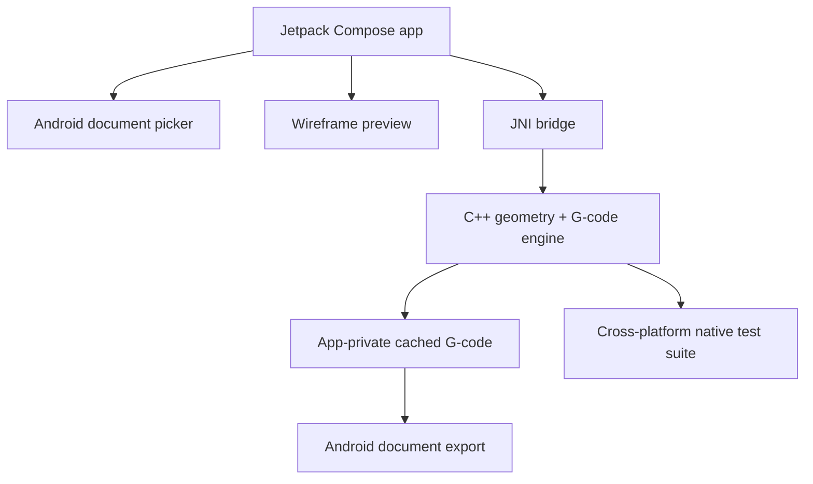

# Architecture and standards

**Android**: Kotlin, Compose, scoped document IO via Storage Access Framework. Avoid legacy broad storage permissions. Run large STL parsing/slicing on Dispatchers.IO/Default, never on the UI thread. Hard cap input size and triangle count.

**C++ native**: `slicer.hpp/.cpp` are standard C++17, intentionally isolated from Android. `jni_bridge.cpp` only converts arguments, handles errors and writes local files. The native tests compile and execute on a regular workstation with CMake. No server or desktop application is required to create slices.

**Slicing**: Triangle/plane intersections → quantized segment graph → closed contours → winding normalization → rudimentary inset perimeter paths → scanline fill → basic relative-E FDM G-code. Each geometric stage will eventually have separate modules and adversarial test fixtures. Current polygon inset implementation intentionally does not claim manufacturing-grade robustness.

**Security**: No network permission, no cloud telemetry or printer automation in alpha. Creality desktop installer is a local reference supplied for comparison, excluded from Git. No authentication tokens committed. Printers must be integrated separately with authenticated protocols and transport protections.

**Quality gate**: Green native tests, Android debug build, physical Android device performance tests, slicer geometry golden fixtures, independent G-code inspection, printer-specific macro review and supervised first print, then release signoff. A passing host C++ test is not proof of Android compilation or printer safety.

**Scaling**: When geometry is mature, split the core into triangle repair/import, path geometry, infill, supports, planner, firmware dialect, and G-code serialization. If real multi-agent workflows are available, assign independent branches: Android UI, geometry, profiles/protocols, and test validation. Require one integration pass before merging.
